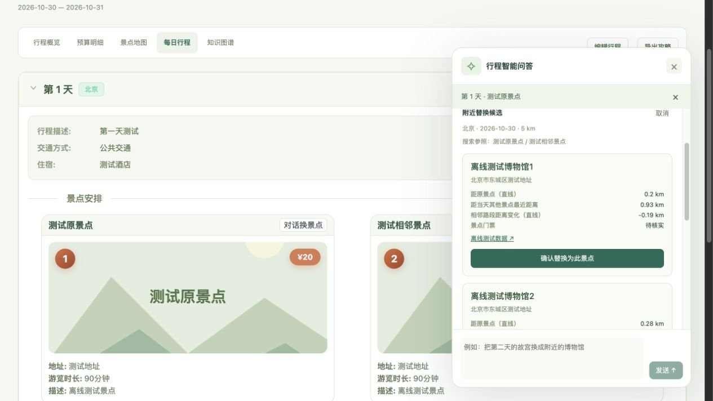

> **公开展示版功能边界**：小红书服务与整个签名目录均未分发，仅保留无网络请求的社区搜索接口占位。实时攻略检索与社区图片下载暂不可用；生成结果没有该来源的事实核验，推荐质量与完整版本不同。地图、天气、规划和对话修改代码保留，外部服务仍须自行配置。历史 91% 基线不能视作本展示版成绩。

# 旅游助手规划

面向短途出行的 AI 旅行规划原型：结构化需求输入、行程生成、预算展示，以及可确认、可撤销的对话式景点替换。

> 本项目基于 [1sdv/TripStar](https://github.com/1sdv/TripStar) 二次开发，保留 GPL-2.0 许可证及上游署名。原有框架与本仓库新增内容见 [来源与改动说明](NOTICE.md)。这是个人产品原型，未提供公开在线服务。

## 功能

- 输入目的地、日期、天数、交通与住宿偏好，并补充自然语言需求。
- 通过现有旅行规划链路整合景点、天气、酒店等信息，展示逐日行程、预算、地图和知识图谱。
- 在每日行程点击「对话换景点」：模型解析修改意图，以原景点及当日相邻景点为参照搜索附近候选。
- 周边检索优先 5 公里，候选不足时扩大至 10 公里，按空间邻近程度和相邻路段直线距离变化排序。
- 用户确认后仅替换一个景点，同步预算与地图数据；支持撤销最近一次对话修改和行程版本校验。
- 保留原有手动编辑、图片导出和中英日界面。HTML 文件导出和公开分享链接尚未实现。



图中地点为明确标注的离线测试数据，用于验证候选展示、确认与撤销，不代表真实搜索结果。

## 运行环境

- Python 3.11+（对话检索使用 `asyncio.timeout`）
- Node.js 18+，推荐 20 或 22
- OpenAI 兼容模型服务；完整功能还需高德、小红书等对应服务配置

### 本地启动

在项目根目录执行（macOS / Linux）：

```bash
python3.11 -m venv backend/.venv
backend/.venv/bin/python -m pip install -r backend/requirements.txt
npm --prefix backend ci
npm --prefix frontend ci
cp backend/.env.example backend/.env
cp frontend/.env.example frontend/.env
```

在本机编辑 `.env` 文件，填写自己的模型及地图配置。模板中的占位值不能直接调用服务：

| 配置 | 用途 |
| --- | --- |
| `LLM_API_KEY` / `LLM_BASE_URL` / `LLM_MODEL_ID` | 模型调用 |
| `VITE_AMAP_WEB_KEY` | 后端高德 Web 服务：地点与周边检索等 |
| `VITE_AMAP_WEB_JS_KEY` / `VITE_AMAP_SECURITY_JS_CODE` | 前端高德地图展示 |
| `XHS_COOKIE` | 原有小红书检索链路 |
| `GOOGLE_MAPS_API_KEY` | 可选的 Google Maps 服务 |

构建并启动：

```bash
npm --prefix frontend run build
cd backend
.venv/bin/python -m uvicorn app.api.main:app --host 127.0.0.1 --port 8000
```

访问 [http://localhost:8000](http://localhost:8000)。也可通过界面的「服务配置」填写本机配置。Web 服务 Key 与前端 JS Key 是不同类型，不能互相替代。

本仓库不包含密钥、Cookie、运行时配置、历史行程、数据库或本地生成记录。配置接口当前用于本地原型，尚无完整账号鉴权，不应直接作为公开在线服务部署。

## 评测与验证

| 项目 | 结果与口径 |
| --- | --- |
| 场景覆盖 | 50 条：典型 25、边界 15、对抗 10 |
| 生成评测 | 每场景重复 2 次，共 100 次；真实模型、模拟外部服务 |
| 评分方式 | 规则校验 + LLM-as-Judge，四维量表，含 AI 复核 |
| 基线可用率 | 91/100；不是线上完成率，也不是优化后的提升幅度 |
| 重复稳定性 | 43/50 个场景的两次结果均达到模拟可用标准 |
| 后端回归 | 33 项通过，其中 17 项覆盖新增对话替换功能 |
| 前端 | 类型检查与生产构建通过；保留现有包体积提示 |

本轮没有真人标注，因此不计算人机一致率；每场景只有 2 次重复，不能计算 pass^5。生成与评审使用同源模型，评分存在相关偏差。详细口径及问题归因见 [评测说明](docs/evaluation.md)。

离线回归（无需真实服务调用）：

```bash
cd backend
.venv/bin/python -m unittest discover -s tests -v
```

真实模型评测脚本在 `evals/`，执行前应阅读 [评测说明](docs/evaluation.md)，这类运行会调用已配置模型并产生费用。

## 当前边界

- 对话修改一次替换一个景点；整天重排、酒店联动、自动天气重规划仍未实现。
- 周边距离为直线估算，不能视为实际交通路线、时长或路费。
- 高德消费均价不能当门票。未知门票显示「待核实」，预算显示「已知费用小计」；有门票硬上限时，未知价格候选不能直接应用。
- 修改保存在当前浏览器会话，原始历史计划不覆盖；撤销记录仅在当前页面内保留。
- 截至 2026-10-26，本地高德真实接口验证返回 `10001`（认证失败）。离线替换流程通过，真实候选质量仍需使用有效 Web 服务 Key 验证。

## 目录

```text
backend/          FastAPI、规划服务、周边检索及回归测试
frontend/         Vue 3 + TypeScript 界面
evals/            生成评测、模拟服务与模型评审脚本
docs/             功能说明、脱敏评测摘要和截图
tripstar-skill/    上游随附的集成资料
```

上游说明保留于 [README.upstream.md](README.upstream.md)、[README_en.md](README_en.md) 和 [README_ja.md](README_ja.md)，其中功能与版本信息以原项目为准。本仓库当前行为以本页及 `docs/` 为准。

## 许可证

沿用上游 [GNU GPL v2](LICENSE)。请保留原作者版权与许可证信息，具体条件以许可证原文为准。

本公开展示版不包含小红书服务和签名源码。社区搜索接口只返回不可用状态，不执行网络请求。

公开版模拟评测通过 `community_search` 的接口注入合成数据，适合检查其余链路；因检索模块已移除，它不能逐次复现完整版本的历史评测结果。
